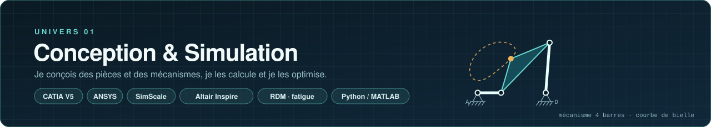
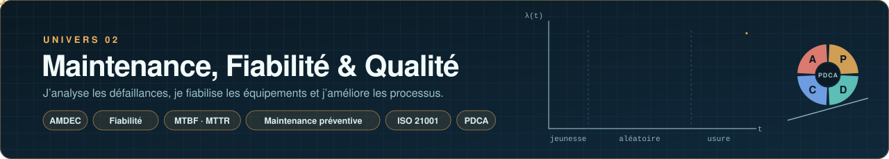

**Élève ingénieur en Génie Mécanique des Systèmes Industriels** 
Mes projets sont rangés en deux univers : choisissez celui qui correspond à votre poste.

<table>
<tr>
<td width="48%" valign="top">

</td>
<td valign="top">

### Genou prothétique polycentrique

**CATIA V5 · Cinématique 4R · RDM · SimScale · Usinage**

Conception complète d’un genou prothétique à quatre barres, du cahier des charges aux gammes d’usinage : synthèse cinématique du mécanisme, dimensionnement, CAO des pièces en Ti-6Al-4V, calcul éléments finis.

- **452 g** pour l’assemblage (cible ≤ 900 g)
- **S ≈ 2,4** en statique sous **4 000 N**, **n ≈ 1,3** en fatigue sous 2 200 N
- **21,7 mm** de migration du centre instantané de rotation

[**🌐 Démo interactive**](https://elmokhtarrayadi.github.io/conception-genou-polycentrique/) · [**📄 Dossier technique**](https://elmokhtarrayadi.github.io/conception-genou-polycentrique/dossier-technique.html) · [Dépôt](https://github.com/elmokhtarrayadi/conception-genou-polycentrique)

</td>
</tr>
<tr>
<td width="48%" valign="top">

</td>
<td valign="top">

### Optimisation d’un engrenage à denture droite

**CATIA V5 · ANSYS · Fatigue · AGMA**

Réduction de la contrainte de flexion au pied de la dent : CAO paramétrique, calcul éléments finis validé par la méthode AGMA, puis comparaison de trois modifications de géométrie.

- **−17 %** de contrainte au pied de la dent (1 008 → 834 MPa)
- **+64 %** de durée de vie en fatigue
- **0,015 %** d’écart entre simulation et calcul AGMA

[**🌐 Démo interactive**](https://elmokhtarrayadi.github.io/optimisation-engrenage-denture-droite/) · [Dépôt](https://github.com/elmokhtarrayadi/optimisation-engrenage-denture-droite)

</td>
</tr>
<tr>
<td width="48%" valign="top">

</td>
<td valign="top">

### Optimisation topologique d’une pièce aéronautique

**CATIA V5 · Altair Inspire · PolyNURBS · Cura**

Allègement d’un support de porte de train d’atterrissage : optimisation topologique, reconstruction de la forme, plan d’expériences de fabrication additive et étude de coûts.

- **55 g → 24 g** : **−56 %** de masse
- **12 configurations** d’impression comparées (orientation, couche, vitesse)
- Analyse critique du résultat mécanique et pistes de la prochaine itération

[**🌐 Démo interactive**](https://elmokhtarrayadi.github.io/optimisation-topologique-aeronautique/) · [Dépôt](https://github.com/elmokhtarrayadi/optimisation-topologique-aeronautique)

</td>
</tr>
</table>

| Compétence | Outils | Projets |
| :-- | :-- | :-- |
| **CAO & mise en plan** | CATIA V5 (paramétrique), SpaceClaim | Genou · Engrenage · Optimisation topologique |
| **Calcul de structures** | RDM, ANSYS, SimScale, Altair Inspire, fatigue | Genou · Engrenage · Optimisation topologique |
| **Dimensionnement d’organes** | Engrenages (Lewis, AGMA), liaisons, matériaux | Engrenage · Genou |
| **Cinématique** | Mécanisme 4 barres, CIR, Python / MATLAB | Genou |
| **Optimisation & fabrication** | Optimisation topologique, PolyNURBS, Cura, gammes d’usinage, coûts | Optimisation topologique · Genou |
| **Analyse fonctionnelle** | APTE, SysML, cahier des charges | Genou |

<a href="#maintenance">Voir l’univers Maintenance, Fiabilité &amp; Qualité ↓</a>

<table>
<tr>
<td width="48%" valign="top">

</td>
<td valign="top">

### Diagnostic qualité ISO 21001

**Audit · Ishikawa 5M · PDCA · KPI**

Diagnostic du système de management de la qualité d’une école d’ingénieurs : évaluation, analyse des causes et plan d’amélioration chiffré.

- **72 critères** évalués sur les 7 chapitres d’exigences
- **15 causes** analysées, **14 actions** avec responsable, délai et KPI
- Priorité identifiée : planification (**46 %** de conformité)

[**🌐 Démo interactive**](https://elmokhtarrayadi.github.io/diagnostic-iso-21001/) · [Dépôt](https://github.com/elmokhtarrayadi/diagnostic-iso-21001)

</td>
</tr>
</table>

🔧 Mes projets de maintenance et de fiabilité sont en cours de mise en ligne.

| Compétence | Outils | Projets |
| :-- | :-- | :-- |
| **Analyse des causes** | Ishikawa 5M, analyse des écarts, priorisation | Diagnostic ISO 21001 |
| **Management de la qualité** | ISO 21001, ISO 9001, audit, KPI | Diagnostic ISO 21001 |
| **Amélioration continue** | PDCA, plan d’action, tableaux de bord | Diagnostic ISO 21001 |

<a href="#conception">↑ Revenir à l’univers Conception &amp; Simulation</a>

Chaque projet a une démo interactive en ligne et un README qui détaille la démarche, les résultats et les perspectives. Les engrenages, le mécanisme 4 barres et la courbe en baignoire sont calculés puis animés en SVG.

