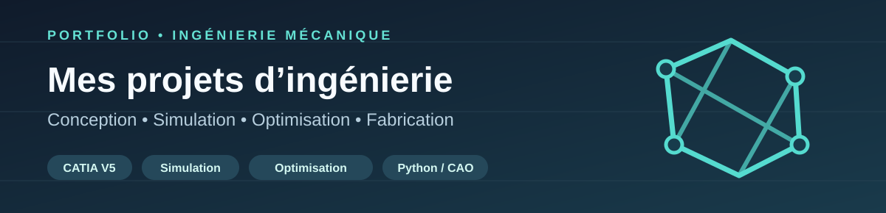

## Elmokhtar Rayadi

**Étudiant ingénieur en Génie Mécanique des Systèmes Industriels**

*Conception mécanique · CATIA V5 · Analyse et simulation · Optimisation · Fabrication additive*

**Bienvenue !** Découvrez mes projets d’ingénierie à travers des modèles, des captures de simulation, des résultats commentés et des démonstrations interactives.

### ⬇️ MES PROJETS SONT JUSTE EN DESSOUS ⬇️

[**📂 Voir mes projets**](#mes-projets) &nbsp; • &nbsp; [**🌐 Ouvrir la démo du projet 01**](https://elmokhtarrayadi21-creator.github.io/optimisation-topologique-aeronautique/)

---

## 📂 Mes projets d’ingénierie

**Cliquez sur l’image ou sur « Voir le projet » pour consulter son dossier technique.** Cliquez sur « Démo interactive » pour ouvrir l’application.

<table>
<tr>
<td width="51%" valign="top">

 
Capture réelle : géométrie reconstruite sous CATIA V5.
</td>
<td valign="top">

### 01 · Optimisation topologique aéronautique

**CATIA V5 · Altair Inspire · Cura**

Reconception d’une pièce aéronautique par optimisation topologique et étude de fabrication additive.

**Résultats rapportés :** masse de 55 g à 24 g (allègement estimé ≈ 56 %). Analyse d’un chargement de 2 300 N et étude technico-économique.

**➡️ [VOIR LE PROJET SUR GITHUB](https://github.com/elmokhtarrayadi21-creator/optimisation-topologique-aeronautique)**

**🌐 [OUVRIR LA DÉMO INTERACTIVE](https://elmokhtarrayadi21-creator.github.io/optimisation-topologique-aeronautique/)**

Projet académique réalisé en groupe. Les résultats sont présentés avec leurs limites et vérifications nécessaires.

</td>
</tr>
</table>

> **Portfolio en construction :** les prochains projets de mécanique seront ajoutés ci-dessus, chacun avec sa propre image, sa documentation et, lorsque c’est possible, une démonstration interactive.

---

## 🔍 Comment découvrir mes travaux ?

| Vous souhaitez… | Cliquez ici |
| :-- | :-- |
| Examiner la démarche CAO, la méthode et les résultats | [**Dossier technique — Projet 01**](https://github.com/elmokhtarrayadi21-creator/optimisation-topologique-aeronautique) |
| Voir directement les visualisations et les comparateurs | [**Application interactive — Projet 01**](https://elmokhtarrayadi21-creator.github.io/optimisation-topologique-aeronautique/) |
| Consulter tous les dépôts disponibles | [**Mes repositories**](https://github.com/elmokhtarrayadi21-creator?tab=repositories) |

## 🛠️ Domaines représentés

**Conception / CAO :** CATIA V5, modélisation et reconstruction géométrique.  
**Simulation / Optimisation :** Altair Inspire, chargements, interprétation des facteurs de sécurité et optimisation topologique.  
**Industrialisation :** fabrication additive, étude des paramètres Cura, analyse des coûts.  
**Valorisation numérique :** interfaces interactives HTML, CSS et JavaScript.

---

### Pour un recruteur

**Commencez par [Mes projets d’ingénierie](#mes-projets).** Chaque projet possède son propre dépôt, ses illustrations et ses résultats. Les nouvelles études seront progressivement intégrées au même endroit.

[**Voir le projet 01**](https://github.com/elmokhtarrayadi21-creator/optimisation-topologique-aeronautique) · [**Lancer la démo**](https://elmokhtarrayadi21-creator.github.io/optimisation-topologique-aeronautique/)

